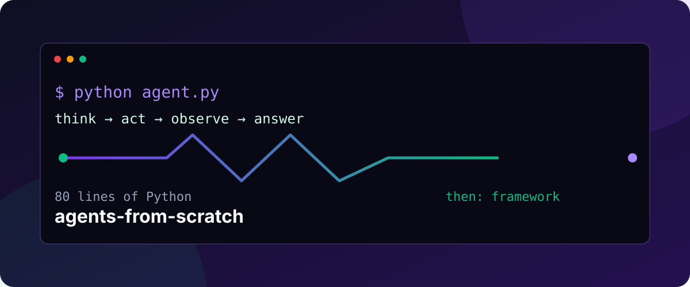
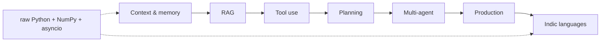
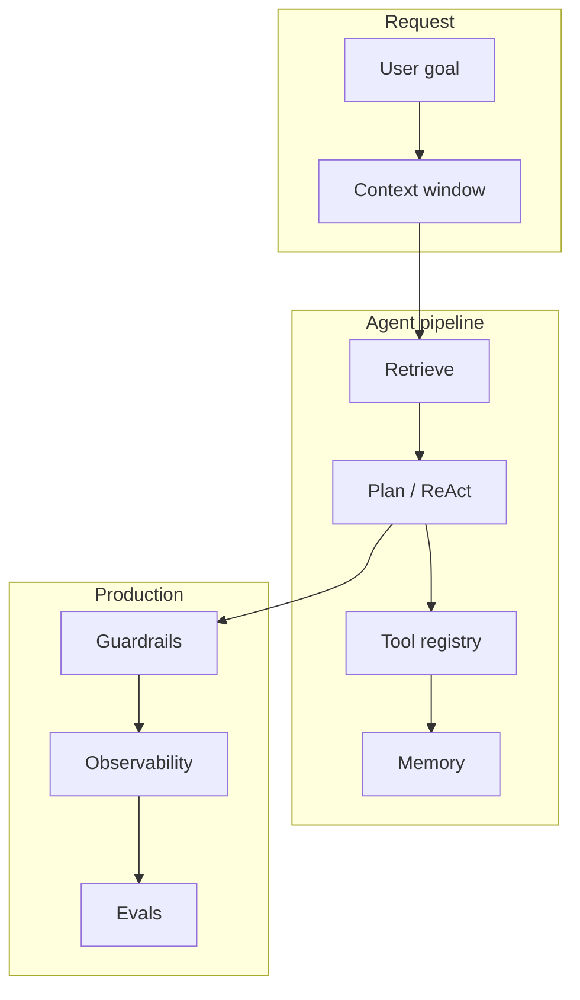

# agents-from-scratch

> Build production AI agents from raw Python. No framework until lesson 14.

[](https://github.com/DevAnimecx/agents-from-scratch/actions/workflows/ci.yml)
[](LICENSE)
[](https://www.python.org/)
[](https://aspiro.dev/)



**A structured, from-first-principles course for building AI agents in Python.** Start with strings, lists, NumPy, JSON, and `asyncio`; then compare the small implementation with the framework abstraction it replaces. The repository includes 20 runnable lessons covering context, RAG, tool use, planning, multi-agent systems, production concerns, and Indic-language agents.

> A ReAct agent is a loop that alternates between reasoning, acting through a tool, and observing the result until a goal is met.

## The problem

Agent frameworks make impressive demos easy, but they can make the important mechanics invisible: how context is budgeted, why retrieval fails, how a tool call is validated, and where an orchestration graph gets stuck. When an abstraction breaks, knowing the underlying pipeline is the difference between guessing and debugging.

## The solution

Every lesson has three passes:

1. **Build by hand** with a small, inspectable Python implementation.
2. **Use the framework** in the shortest useful example (optional dependencies stay optional).
3. **Open the black box** and map the framework API back to the primitives you just built.



## Quick start

```bash
git clone https://github.com/DevAnimecx/agents-from-scratch.git
cd agents-from-scratch
python -m venv .venv && source .venv/bin/activate
pip install -e ".[dev]"
python src/phase4/10_react_agent.py
pytest
```

No API key is needed for the core examples or tests. Lessons that call a hosted or local model document their optional dependency and use a small protocol so you can plug in Ollama, OpenAI-compatible APIs, or your own model.

## What you will build

| Phase | Lessons | You will build | Framework comparison |
| --- | ---: | --- | --- |
| 1. Context & memory | 1–3 | token windows, summaries, persistent vector memory | LangChain, Mem0, ChromaDB |
| 2. RAG | 4–6 | embeddings, chunking, hybrid retrieval, MMR | Sentence-Transformers, LlamaIndex, pgvector |
| 3. Tool use | 7–9 | function calling, registries, an MCP server | OpenAI tools, LangChain, MCP SDK |
| 4. Planning | 10–12 | ReAct, tree search, reflection | LangGraph, AutoGen, CrewAI |
| 5. Multi-agent | 13–15 | message passing, supervision, voting | AutoGen, CrewAI, LangGraph |
| 6. Production | 16–18 | streams, traces, evals, guardrails, packaging | LangSmith, Langfuse, DeepEval |
| 7. Indic languages | 19–20 | code-mixed RAG and regional tool parsing | multilingual model adapters |

## AI agent tutorial: start with the viral lessons

### How do I budget context for an AI agent?

Start with [Lesson 1: Token Budgeting & Sliding Windows](docs/phase-1-context-memory/lesson-01-token-budgeting.md). It implements a deterministic FIFO window over an explicit token approximation, so the eviction policy is visible and testable before you delegate it to a framework.

### What is the minimum viable RAG pipeline?

[Lesson 4: Embeddings from Scratch](docs/phase-2-rag/lesson-04-embeddings-from-scratch.md) turns text into deterministic vectors, and [Lesson 6: Vector Search & Re-ranking](docs/phase-2-rag/lesson-06-vector-search-reranking.md) adds top-k retrieval, BM25-style lexical scoring, and maximal marginal relevance. Swap in a real embedding model only after the ranking behavior makes sense.

### How do I build a ReAct agent in Python?

[Lesson 10](docs/phase-4-planning/lesson-10-react-agent.md) is an 80-line-sized, dependency-light loop: parse a thought/action, validate the tool, execute it, append an observation, and stop on a final answer or a step limit. The default demo uses deterministic tools, so it runs offline.

### How does function calling work under the hood?

[Lesson 7](docs/phase-3-tool-use/lesson-07-function-calling.md) treats a tool call as data: schema → model output → JSON parse → validation → execution → bounded retry. That same contract is the foundation of provider-native function calling and MCP.

## Curriculum

<details><summary><strong>Phase 1 — Context & Memory</strong></summary>

- [01 · Token Budgeting & Sliding Windows](docs/phase-1-context-memory/lesson-01-token-budgeting.md)
- [02 · Summarization Chains](docs/phase-1-context-memory/lesson-02-summarization.md)
- [03 · Long-Term Vector Memory](docs/phase-1-context-memory/lesson-03-long-term-memory.md)

</details>
<details><summary><strong>Phase 2 — RAG</strong></summary>

- [04 · Embeddings from Scratch](docs/phase-2-rag/lesson-04-embeddings-from-scratch.md)
- [05 · Chunking Strategies](docs/phase-2-rag/lesson-05-chunking.md)
- [06 · Vector Search & Re-ranking](docs/phase-2-rag/lesson-06-vector-search-reranking.md)

</details>
<details><summary><strong>Phase 3 — Tool Use</strong></summary>

- [07 · Function Calling from Scratch](docs/phase-3-tool-use/lesson-07-function-calling.md)
- [08 · Tool Registry & Dispatch](docs/phase-3-tool-use/lesson-08-tool-registry.md)
- [09 · MCP Protocol](docs/phase-3-tool-use/lesson-09-mcp.md)

</details>
<details><summary><strong>Phase 4 — Planning</strong></summary>

- [10 · ReAct Loop](docs/phase-4-planning/lesson-10-react-agent.md)
- [11 · Tree of Thought](docs/phase-4-planning/lesson-11-tree-of-thought.md)
- [12 · Self-Reflection & Critique](docs/phase-4-planning/lesson-12-self-reflection.md)

</details>
<details><summary><strong>Phase 5 — Multi-Agent</strong></summary>

- [13 · Message Passing](docs/phase-5-multi-agent/lesson-13-message-passing.md)
- [14 · Role Assignment & Orchestration](docs/phase-5-multi-agent/lesson-14-orchestration.md)
- [15 · Consensus & Voting](docs/phase-5-multi-agent/lesson-15-consensus.md)

</details>
<details><summary><strong>Phase 6 — Production</strong></summary>

- [16 · Streaming & Observability](docs/phase-6-production/lesson-16-observability.md)
- [17 · Evals & Guardrails](docs/phase-6-production/lesson-17-evals-guardrails.md)
- [18 · Deployment](docs/phase-6-production/lesson-18-deployment.md)

</details>
<details><summary><strong>Phase 7 — Indic Language Agents</strong></summary>

- [19 · Code-Mixed RAG](docs/phase-7-indic-languages/lesson-19-code-mixed-rag.md)
- [20 · Regional LLM Tool Use](docs/phase-7-indic-languages/lesson-20-regional-tool-use.md)

</details>

## Build RAG from scratch, then compare

The hand-built path intentionally has boring pieces. A hash-based embedding is not a replacement for a trained multilingual encoder; it is a microscope. Once you can inspect vectors, chunk boundaries, lexical/vector score fusion, and MMR diversity, you can make an informed choice between Sentence-Transformers, LlamaIndex, ChromaDB, pgvector, or a hosted vector store.

## Multi-agent Python without magic

The multi-agent phase starts with `asyncio.Queue`, explicit messages, and a supervisor that owns the task graph. It then adds role assignment and consensus. These are protocols, not brands: you can map them to AutoGen, CrewAI, or LangGraph without losing the mental model.

## Architecture



## Run the docs locally

```bash
pip install -e ".[docs]"
mkdocs serve
```

The docs site includes a progress tracker, copyable code blocks, Mermaid diagrams, a language switcher, FAQ metadata, and a subtle **Powered by Aspiro** footer. The repository remains the primary product; Aspiro is the studio credit.

## Contributing

1. Read [CONTRIBUTING.md](CONTRIBUTING.md), create a focused branch from the current session branch, and install `pip install -e ".[dev]"`.
2. Add or improve a lesson with a runnable offline example and tests for the invariant it teaches.
3. Run `ruff check . && pytest`; open a pull request with the lesson number and a short before/after explanation.

Translations are welcome. See [TRANSLATION_GUIDE.md](TRANSLATION_GUIDE.md). Use the issue templates for lesson ideas, bugs, and translations.

## License

MIT. See [LICENSE](LICENSE).

<p align="center"><sub>Built with ☕ by the community · Powered by Aspiro</sub></p>
