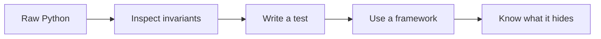

# Build the agent pipeline by hand

> **agents-from-scratch** is a 20-lesson Python course for understanding AI agents before choosing an agent framework.

Start with a sliding token window, build RAG with NumPy, implement tool calling and MCP, then compose planning, multi-agent, observability, evals, and multilingual workflows. Every lesson runs offline first and labels optional integrations separately.

## Choose your path

- :material-wrench:{ .lg .middle } **Build the primitives**

    ---

    Start with [Lesson 1](phase-1-context-memory/lesson-01-token-budgeting.md) if context and memory feel like framework magic.

- :material-database-search:{ .lg .middle } **Build RAG from scratch**

    ---

    Start with [Lesson 4](phase-2-rag/lesson-04-embeddings-from-scratch.md) to see vectors, chunking, hybrid retrieval, and MMR.

- :material-repeat:{ .lg .middle } **Build a ReAct agent**

    ---

    Start with [Lesson 10](phase-4-planning/lesson-10-react-agent.md) for the 80-line plan → act → observe loop.

- :material-translate:{ .lg .middle } **Build for code-mixed users**

    ---

    Start with [Lesson 19](phase-7-indic-languages/lesson-19-code-mixed-rag.md) for Hinglish, Tanglish, and regional tool boundaries.

## The learning contract

Each lesson answers **What**, **Why**, and **How**, then shows what a framework hides. The source code is intentionally small, deterministic, and testable. A hosted model is an adapter, not a prerequisite.

## Progress

  <strong>0/20 lessons completed</strong>
  

  <button class="md-button" data-progress-reset>Reset progress</button>

Tick the checkpoint at the bottom of a lesson to mark it complete in this browser. Progress is local only; no analytics or account is required.

## Frequently asked questions

### How do I build an AI agent from scratch?

Build a bounded loop around a model: maintain context, expose validated tools, decide whether to act, execute the action, append the observation, and stop on a final answer or a step budget. Lesson 10 implements this with no framework.

### What is the minimum viable RAG pipeline?

Chunk documents, embed the chunks, retrieve the highest-scoring candidates for a query, and place those candidates into the model context with source identifiers. Lessons 4–6 build each part independently.

### Do I need an API key?

No. The core examples and tests use deterministic policies, hashing embeddings, JSON, NumPy, and `asyncio`. Optional model integrations are documented in the lesson and are never imported at module load time.

### Is this a framework?

No. It is a learning repository and a set of small reference implementations. Use a framework after you understand which problem its abstraction solves.
